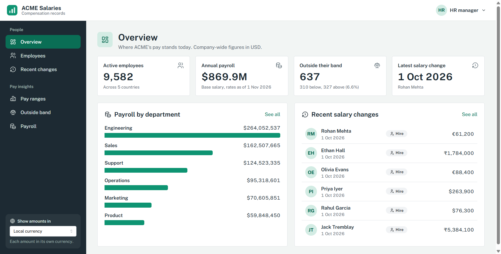
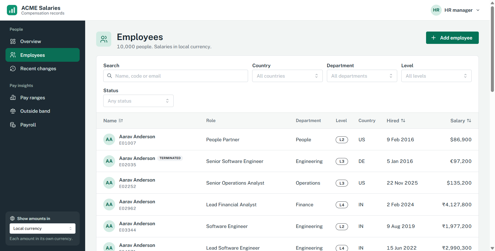
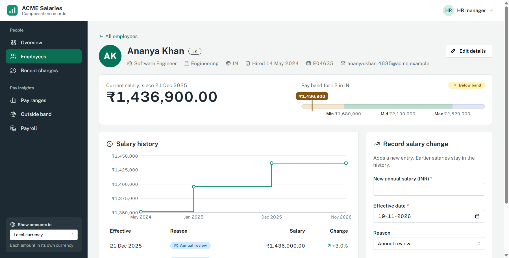
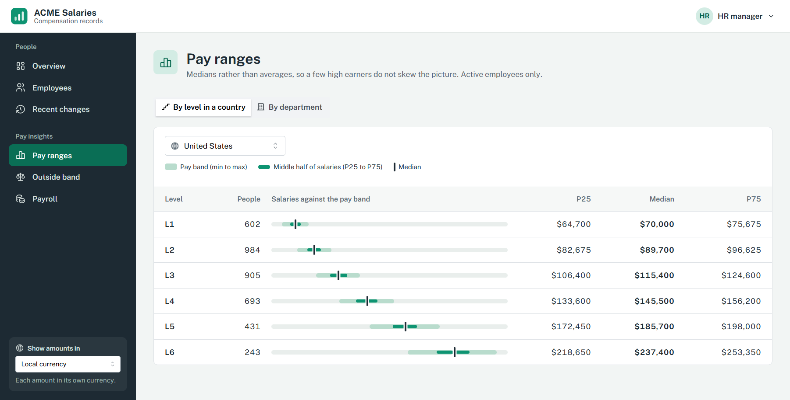
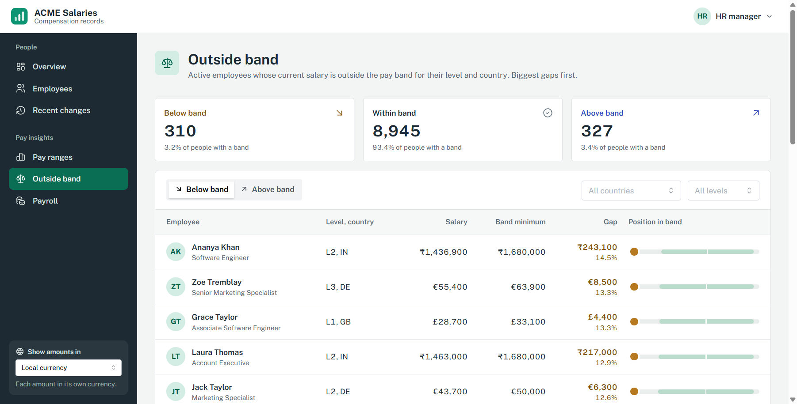
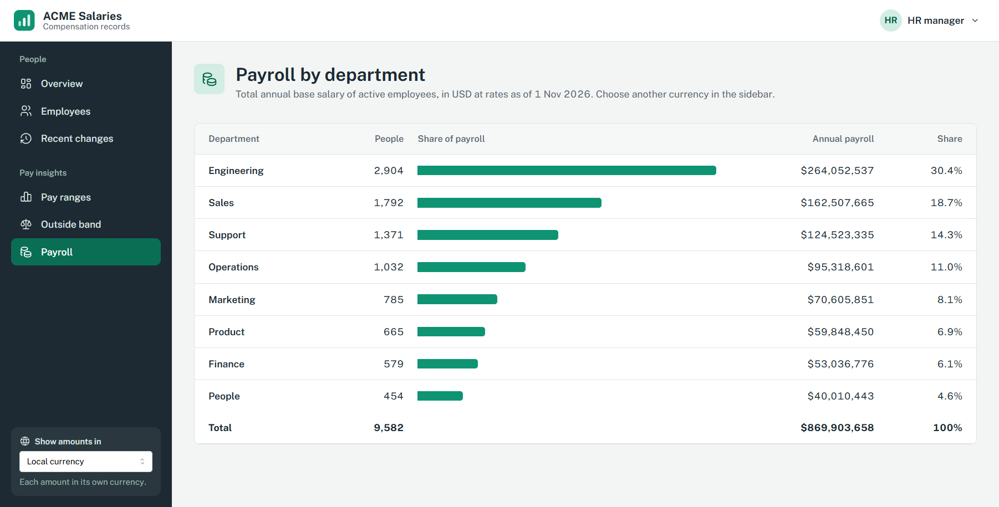

# ACME Salary Management

A web app that replaces ACME's salary spreadsheets. The HR manager can find and update any of 10,000 employees in seconds, see each person's full pay history, and answer common pay questions without building a pivot table.



**Live:** app at https://acme-salaries-web.onrender.com, API at https://acme-salaries-api.onrender.com, database on Neon. Both run on Render's free plan; the API sleeps after 15 idle minutes, so the first sign-in after a pause can take up to a minute. Demo password: `acme-hr-demo-2026` (published on purpose so reviewers can sign in; all data is synthetic, see [security](docs/security.md)).

## What it answers

| HR manager's question | Where |
| --- | --- |
| What is this employee paid, and how has it changed over time? | Employees, then the employee's profile |
| What is the median pay (and spread) for a level or department in a country? | Pay ranges |
| Who is paid below or above the pay band for their level and country? | Outside band, and the band bar on every profile |
| What does each department cost in total payroll, in one currency? | Payroll |
| Whose salary changed recently, and why? | Recent changes, and the Overview page |

Every amount can be shown in local currency or converted to USD, EUR, GBP, INR or CAD. Converted figures show the date of the FX rates used.

## Repository layout

```
REQUIREMENTS.md     One-page requirements, written before any code
CLAUDE.md           Rules for AI agents working in this repo
backend/            Express + Knex + PostgreSQL API (own package.json, tests, README)
frontend/           React + Vite app (own package.json, tests, README)
docs/
  plan.md           Milestone plan, ticked as the work progressed
  architecture.md   How the pieces fit together
  trade-offs.md     What was chosen, what was left out, and why
  performance.md    Query plans and response times on 10,000 employees
  ai/prompts.md     Prompts and agent instructions used
  ai/review-log.md  Where AI output was wrong and how it was caught
docker-compose.yml  PostgreSQL for local development
```

The two projects share no code. The frontend calls the API over HTTP and defines its own response types.

## Run it locally

You need Node.js 24 and PostgreSQL 16 or later.

1. Start PostgreSQL. With Docker:

   ```bash
   docker compose up -d
   ```

   Or use any local PostgreSQL and change the URLs in step 2.

2. Set up and seed the backend:

   ```bash
   cd backend
   cp .env.example .env      # edit DATABASE_URL / DATABASE_URL_TEST if needed
   npm install
   npm run db:create         # creates the acme and acme_test databases
   npm run migrate
   npm run migrate -- --test
   npm run seed              # 10,000 employees, about 1 second
   npm run dev               # API on http://localhost:4000
   ```

3. In another terminal, start the frontend:

   ```bash
   cd frontend
   cp .env.example .env
   npm install
   npm run dev               # app on http://localhost:5173
   ```

4. Open http://localhost:5173 and sign in with the `AUTH_PASSWORD` from `backend/.env` (`acme-hr-demo-2026` in the example file).

## Tests

```bash
cd backend && npm test     # 77 tests: unit + integration against real PostgreSQL, about 6 s
cd frontend && npm test    # money parsing and formatting, under 1 s
```

GitHub Actions runs each project's suite on every push that touches it (`.github/workflows/`).

## Screenshots

Taken from the live app.

| Employee directory | Profile with pay band and history |
| --- | --- |
|  |  |

| Pay ranges by level | Outside band |
| --- | --- |
|  |  |

| Payroll by department | Overview |
| --- | --- |
|  |  |

## More detail

- [Backend README](backend/README.md): API, data model, scripts
- [Frontend README](frontend/README.md): pages, design, structure
- [Architecture](docs/architecture.md), [trade-offs](docs/trade-offs.md), [performance](docs/performance.md), [security](docs/security.md)
- [AI prompts](docs/ai/prompts.md) and [AI review log](docs/ai/review-log.md)
